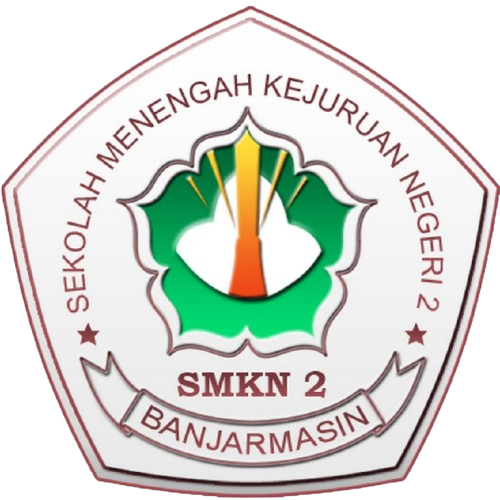

<p align="center">
  
</p>

<h1 align="center">Pilketos — SMKN 2 Banjarmasin</h1>

<p align="center">Aplikasi voting Ketua & Wakil Ketua OSIS berbasis QR code sekali pakai.</p>

Setiap murid mendapat kartu QR pribadi dari panitia. Pada hari pemilihan,
operator bilik memindai QR murid untuk membuka halaman pilihan, murid memilih
satu paslon lalu mengunci pilihannya. Satu QR hanya berlaku untuk satu suara —
setelah dipakai, QR tidak bisa memilih lagi.

## Fitur

- **Halaman utama** — profil paslon, status pemilihan (dibuka/ditutup), dan
  tombol masuk ke bilik suara.
- **Bilik suara** — scan QR via kamera, pilih paslon (2 paslon tampil
  kiri-kanan dengan foto penuh), popup konfirmasi, bunyi sukses + toast hijau
  saat suara tercatat.
- **Panel admin** (`/admin`) — kelola murid (import Excel Dapodik), kandidat,
  pengguna, dan suara; cetak kartu QR massal (4 per halaman A4) atau per murid
  (langsung unduh PDF); buka/tutup pemilihan; dashboard hasil suara.
- **Login bilik** (`/login`) — khusus operator/scan dengan tombol show/hide
  password.

## Cara memasang

```bash
# 1. Clone repo
git clone https://github.com/Ghaizan17/pilketos.git
cd pilketos

# 2. Install dependensi
composer install
npm install

# 3. Siapkan environment
cp .env.example .env
php artisan key:generate
touch database/database.sqlite

# 4. Migrasi + data awal
php artisan migrate --seed

# 5. Build aset frontend
npm run build

# 6. Jalankan
php artisan serve
```

Lalu buka:

- `http://127.0.0.1:8000` — halaman utama
- `http://127.0.0.1:8000/admin` — panel admin
- `http://127.0.0.1:8000/login` — login bilik
- `http://127.0.0.1:8000/bilik` — scan suara (perlu login + kamera)

Teknologi: Laravel + Filament + SQLite + Tailwind + Alpine.js.
